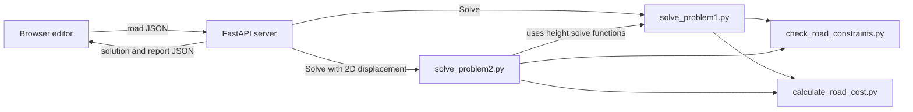

# Road Optimizer

`road-editor-solver-app` is a web app for planning a road on a terrain map. Set the route, road limits, and cost rates in the 2D editor. Use **Solve** to find road heights, or **Solve with 2D displacement** to also move the route sideways. The app shows the result on a 3D terrain view.


## Requirements

Python 3.14 or newer, `uv`, Node.js, npm, and tmux.

## Run

From the repository root, install the Python and web app packages:

```sh
./install.sh
```

Start the API and web app in one tmux session:

```sh
./run.sh
```

Open `http://127.0.0.1:5173`. Detach from tmux with Ctrl-B, then D. Run `./run.sh` to join the running session, or `./run.sh -r` to restart both servers. The web app sends solve requests to the API at `127.0.0.1:8765`.

## Options 

1. Pick terrain from dropdown.
2. Modify the curve (initial guess)

### Solve
For the fixed 2D curve, solve for vertical alignment (a.k.a. Problem1)

### Solve with 2D displacement
Solve allowing some points to move in 2D space (a.k.a Problem2)


## Python scripts

| File | Purpose |
| --- | --- |
| [`check_road_constraints.py`](scripts/check_road_constraints.py) | Checks road geometry, endpoints, grade, curvature, and terrain coverage. |
| [`calculate_road_cost.py`](scripts/calculate_road_cost.py) | Measures cut and fill volumes and calculates road cost. |
| [`solve_problem1.py`](scripts/solve_problem1.py) | Solves road heights for a fixed 2D route and grades the terrain. |
| [`solve_problem2.py`](scripts/solve_problem2.py) | Searches sideways route moves and solves the road heights for each candidate. |
| [`generate_terrain_examples.py`](scripts/generate_terrain_examples.py) | Creates sample terrain JSON and OBJ files. |
| [`generate_road_obj.py`](scripts/generate_road_obj.py) | Exports a road surface as an OBJ mesh. |

## How the app uses the scripts

The browser editor in [`road-editor-solver-app/src/main.ts`](road-editor-solver-app/src/main.ts) builds a road JSON document from the route, terrain, limits, and costs. It sends that document to [`server.py`](road-editor-solver-app/server.py). The server writes temporary input files, calls the solver functions directly, reads their solution and report files, and sends the results back to the browser. The browser then updates the route and 3D terrain view.



The app loads its sample terrain JSON from `road-editor-solver-app/public/terrains`. The terrain generator writes to `data/terrains` by default, so it does not change the app's bundled terrain files. The 3D view draws its own meshes and does not run `generate_road_obj.py`.

See the [app README](road-editor-solver-app/README.md) for more details.
