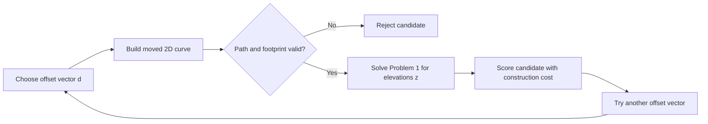

# Problem 2: Move a 2D road and solve earthwork

## Goal

Given a sampled 2D road curve, move its interior vertices along their original planar normals. Keep the endpoints fixed. For each candidate 2D curve, solve [Problem 1](problem1-solve-earthwork.md) to choose its road elevations and calculate its minimum construction and earthwork cost. Find a low-cost curve that meets the [Problem 0](problem0.md) road constraints. A selected-point search is one optional step within this joint problem.

## Given data

Use the original bilinear ground surface $H(x,y)$, endpoint indices $A$ and $B$, road width $w$, grade limit $\mathrm{maxs}$, discrete curvature limit $\mathrm{maxc}$, and nonnegative cost rates from [Data conventions](data-convention.md). The endpoint positions and elevations come from the original heightmap.

Let the sampled baseline curve have horizontal vertices $p_i^0=(x_i^0,y_i^0)$ for $i=0,\ldots,n$, where $n\geq2$. The first and last vertices must match the horizontal positions of $A$ and $B$. Require positive baseline segment lengths and no undefined reversal so that each baseline vertex normal $N_i^0$ can be constructed as in Problem 0. The baseline's interior elevations, if supplied, are initial display values only and do not constrain this problem.

For each interior vertex, provide finite offset bounds $\underline d_i\leq0\leq\overline d_i$, measured in metres along $N_i^0$. Choose the baseline samples and bounds before optimization. The number and order of vertices remain fixed.

## Candidate horizontal curve

The outer decision vector is $d=(d_1,\ldots,d_{n-1})$. Define $d_0=d_n=0$ and move each vertex by

$$
p_i(d)=p_i^0+d_iN_i^0,\qquad i=0,\ldots,n.
$$

The displacement directions $N_i^0$ stay fixed during the joint search. For each candidate $d$, construct new road normals from the moved curve when calculating its footprint. A moved curve is not valid merely because its offsets are within their bounds.

Let $\ell_i(d)=\lVert p_{i+1}(d)-p_i(d)\rVert$. Before solving elevations, require positive segment lengths, no undefined reversal, the Problem 0 discrete curvature limit, full footprint coverage by the heightmap, a positive strip area element, and no overlap between strip interiors. Use the candidate curve and its new normals for all these checks. Also reject a candidate if its fixed endpoint elevations cannot meet the grade limit:

$$
|z_B-z_A|>\mathrm{maxs}\sum_{i=0}^{n-1}\ell_i(d).
$$

## Inner elevation problem

For a valid candidate curve, let $C_d(z)$ be the Problem 1 cost calculated with the candidate footprint and the original ground surface. Reoptimize all interior elevations $z_1,\ldots,z_{n-1}$, including elevations at horizontal vertices that did not move in a particular outer trial. The endpoint elevations are fixed, and every segment must meet the grade limit. Define the best cost for that candidate as

$$
F(d)=\min_z\left\{C_d(z):z_0=z_A,\ z_n=z_B,\ |z_{i+1}-z_i|\leq\mathrm{maxs}\,\ell_i(d)\text{ for all }i\right\}.
$$

For each fixed valid $d$, this is the convex vertical optimization problem from Problem 1. It uses 3D road length, separate cut and fill volumes, and import or export volume based on the net soil balance for the full road. Set $F(d)=+\infty$ for an invalid candidate.

## Outer horizontal problem

Solve

$$
\begin{aligned}
\underset{d\in\mathbb R^{n-1}}{\operatorname{minimize}}\quad &F(d)\\
\text{subject to}\quad &\underline d_i\leq d_i\leq\overline d_i,\qquad i=1,\ldots,n-1.
\end{aligned}
$$

The candidate checks in the previous section are part of the domain of $F$. The outer problem uses the same construction cost as Problem 1; it adds no cost for moving a baseline vertex. The offsets only restrict which horizontal curves may be considered.

## Selected-point search

A selected-point search changes one component of the current offset vector. Given current offsets $\bar d$ and selected interior index $j$, set $d(t)=\bar d+t e_j$, where $e_j$ has value 1 at index $j$ and 0 elsewhere. Solve

$$
\min_t F(\bar d+t e_j)\quad\text{subject to}\quad\underline d_j-\bar d_j\leq t\leq\overline d_j-\bar d_j.
$$

This is a one-dimensional search. It can improve the current road when a useful move exists along that one normal. It can also stop with no improvement while a joint move would help. For example, a curvature limit may reject a move of one vertex but allow two adjacent vertices to move together and form a smooth bend. Repeated selected-point searches are a coordinate search, not a solution to the joint problem.

## Numerical solution

Start from $d=0$ if the baseline curve is valid and its endpoint elevations are feasible. If it is not, find another feasible starting vector. Search several offsets together, or search blocks of adjacent offsets, so a useful bend can form without first passing through an invalid one-point curve. A selected-point search can refine a feasible solution. Keep the best feasible result, including the baseline when it is valid.

The mathematical $F(d)$ uses the continuous Problem 1 cost. In a numerical implementation, let $z_h(d)$ be the result of the sampled convex solve and score the candidate with a refined cost estimate $\widehat C_d(z_h(d))$. This score estimates the cost of the road that the inner solver actually returns; it is not an exact value of $F(d)$. Apply consistent cost accuracy when comparing candidates. Refine the elevation solve and integration for promising candidates and for the final result. Report the outer search limit, the number of candidate evaluations, the integration tolerance, and the sampled and refined costs.

Problem 1's convexity result applies only when $d$ is fixed. Moving the curve changes its length, normals, footprint, and ground samples. The outer objective and geometric constraints are generally nonconvex. A joint search can find improvements that selected-point searches miss, but it does not prove a global minimum over the offset bounds. The inner sampled elevation solve can still find a global optimum of its own fixed-candidate sampled model, subject to numerical tolerance.

## Outputs

Report the best valid offset vector, moved 2D curve, optimized 3D road curve, and the full Problem 1 cost and constraint report. Include the baseline cost when $d=0$ is valid, the cost change from that baseline, the number of outer candidate evaluations, and the outer termination reason. If no valid candidate is found, report that search outcome without claiming that no valid curve exists. Report invalid input or a numerical failure separately.

## Scope and limits

This model searches only curves obtained by moving the chosen baseline vertices along fixed baseline normals. It cannot change the number or order of vertices, and it may miss a cheaper road that needs a different route shape. The discrete curvature value depends on vertex spacing, so keep the baseline sampling fixed during one solve. Offset bounds do not by themselves prevent folds or overlaps; the candidate geometry checks remain required.

The current Problem 0 checker samples strip boundaries and overlaps, so its geometry checks are approximate. Use more accurate geometry checks before accepting a final curve.

A road with positive width cannot use the current heightmap corner vertices as endpoints under the centered footprint rule in Problem 0. Choose interior endpoints or provide terrain beyond those endpoints before using such data with this problem.

## Current solver

Run `uv run python scripts/solve_problem2.py data/problem1-road-input.json`. The [solver](scripts/solve_problem2.py) reads the same road JSON fields as Problem 1. It uses a symmetric 3 m offset bound for every interior vertex unless the input has a `problem2` object. Set `problem2.max_offset_m` for one common bound, or set `problem2.offset_bounds_m` to one `[lower, upper]` pair for each interior vertex. Every pair must contain zero. The command-line `--max-offset-m` value overrides either input setting.

The solver uses joint smooth displacement directions and a bounded pattern search. Its default limit is 60 candidate evaluations. Use `--max-evaluations`, `--initial-move-m`, `--min-move-m`, and `--seed` to control the search. The Problem 1 quadrature and volume integration flags are also available. The current solver searches a limited set of joint directions; the selected-point search above is a separate possible method. Its stopping condition is not proof of a joint optimum.

By default, an input named `name-input.json` produces `name-problem2-solution.json` and `name-problem2-report.json`. The solution has the optimized 3D curve and a graded heightmap. The report records costs against the original terrain, the offset vector, the baseline comparison, the candidate history, and the search settings.
